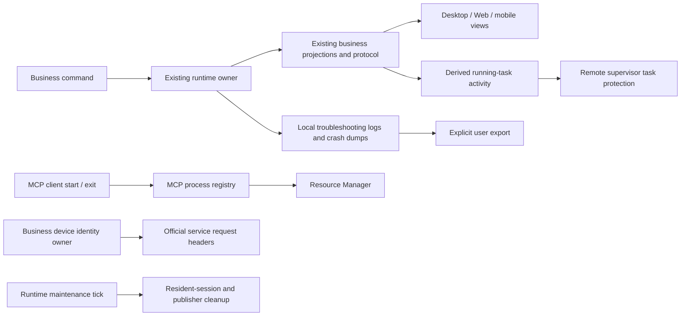

# Remove automatic telemetry from this fork

_Status: accepted_

This personal fork does not need automatic usage analysis or remote monitoring. Remove its automatic telemetry collection and delivery, including behavior analytics, crash and performance reporting, resource reporting, custom OTEL export, and support code used exclusively by those paths. Preserve local troubleshooting logs, explicit log export, user-visible usage, and the business events and maintenance required for normal operation.

The existing device identity is required by official model and subscription services. Keep that identity stable across upgrades and give it an independent business owner and storage rather than retaining the telemetry subsystem to provide it.

## Confirmed boundaries

- Remove telemetry implementations, SDK initialization, dedicated dependencies and patches, platform and protocol interfaces, settings, build-time injection, environment switches, dedicated tests, fixtures, tools, and obsolete documentation. Do not retain disabled implementations or compatibility stubs.
- Preserve ordinary local logs, local crash dumps without upload, explicit log export, user-visible token/cost/context usage, provider authentication and entitlements, Highspeed display/sharing, and the Resource Manager, including its user-initiated local network capture.
- Migrate only the existing business device identity from legacy telemetry state into its independent store. Stop consuming other legacy telemetry state, queues, and caches. Do not introduce a cleanup mechanism or automatically delete existing user files or logs.
- Update affected Desktop, Web, bundled CLI, and remote Server components together. Compatibility with removed upstream telemetry interfaces is outside this change.
- Remove direct telemetry dependencies according to actual consumers. A transitive observability API needed by a model SDK or test runner is not a reason to remove that SDK or runner.

## Ownership and event order

- Keep command admission, session state, replay, owner/lease rules, workspace identity, and stale-run protection with their current business owners. Desktop continuous delivery and mobile replayable delivery retain their existing semantics.
- Derive running-task activity from authoritative business lifecycle facts, covering foreground, detached-child, and background work. Reuse an existing business observer only when its coverage is complete: the sessions index alone excludes detached children. Preserve runtime generation, event order, deduplication, and the supervisor protection; do not create a second accepted-state owner or rely on a terminal-only signal.
- Extract CUA permission observation from the telemetry normalization entry point without changing its event ordering, deduplication, or trusted delivery scope.
- Extract MCP process registration from its telemetry tracker. Preserve process/plugin ownership and the existing process-query interface.
- Remove the purchase-entry inventory and loading gate that existed only to populate funnel events. Purchase dialogs retain their own data loading and entitlement rules.
- Keep resident-session rebalance, event-store pruning, and detached-child publisher cleanup on an explicit maintenance lifecycle after removing the resource-reporting sampler. Local diagnostic logging may use the same lifecycle.
- Give device identity one asynchronous read/write path shared through public package interfaces. Preserve existing values, concurrency protection, and failure handling; initialize identity before requests that require it. Legacy state is only an identity migration source.
- Preserve business assembly facts such as Desktop presentation surface, recoverable-command timestamps, tool exit status consumed by local usage accounting, and local workspace-hook trust-review logs even when their current names or container types mention telemetry.

## Acceptance evidence

- No application-owned telemetry SDK, exporter, endpoint, background reporting queue, or pure reporting sampler remains active, and retired telemetry environment settings cannot reactivate it. Release builds no longer require telemetry credentials or endpoints.
- Desktop and Web can create, open, resume, send to, cancel, and render conversations, including tools, permissions, compaction, user-visible usage, Desktop context hints, and Highspeed display/sharing. Mobile remote-control delivery and reconnect/replay preserve their current contracts.
- Official model and subscription requests retain their business device identity across upgrade. Remote running-task protection (including detached/background work), CUA permission hints, Resource Manager process ownership, and session/publisher cleanup continue to work.
- Local logging, non-uploading crash capture, and explicit log export remain functional.
- Remove obsolete telemetry-only tests and keep meaningful regression evidence for the extracted business capabilities. Run root typecheck, lint, architecture checks, the CLI's own typecheck/lint/test entry points, affected package tests, and appropriate build checks; report actual results and any environment limits.

The user confirmed the complete design before implementation.

## Validation on 2026-10-17

- Root `pnpm typecheck`, CLI `pnpm --dir apps/zcode-cli typecheck`, Desktop `typecheck:e2e`, and `pnpm architecture:check --changed` passed. The architecture checker reported zero violations within its configured coverage.
- Root unit tests passed: 1,812 files and 16,878 tests, with two files and 20 tests skipped. Regression evidence includes stable device identity migration, official request headers, remote connection admission and workspace identity, live detached-session activity, replay isolation, CUA permissions, MCP process ownership, runtime maintenance, clipboard actions, and non-uploading local crash capture and archival.
- Root lint passed with zero errors and 57 existing warnings. CLI lint retains 85 existing errors, compared with 87 in the baseline; no new error locations or diagnostics were introduced.
- The CLI full test entry point was run. Its existing contract, provider fixture, core, bootstrap, TUI and SEA test failures remain. Additional OAuth/timing-sensitive failure labels passed focused reruns; obsolete telemetry assertions were removed while business assertions were retained. This is not a claim that the CLI full suite passes.
- Desktop production bundles, Web production build and the bundled CLI build passed. A clean Desktop production build removed stale development output, and the resulting Main bundle retains local crash capture without remote upload. Existing Vite chunk-size warnings remain.
- The conversation case coverage audit and formatting checks for changed root and CLI files passed. Global `pnpm fmt:check` still encounters existing formatting and vendored HTML parse failures; comparison against the baseline found no newly listed files or parse failures.
- The additional full Desktop TypeScript build still reports 206 existing diagnostics, compared with 248 in the baseline, with no new diagnostic signatures after normalizing checkout paths. Knip still reports repository-wide existing issues; no new unused files were introduced.
- Validation ran on Linux with the pinned Node and pnpm versions. Interactive Desktop/mobile relay E2E, Windows/macOS runtime checks and installer packaging were not performed.
