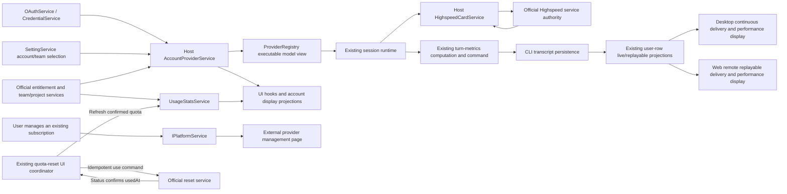

# Remove in-app marketing from this fork

_Status: accepted_

This personal fork does not need sales or user-acquisition flows. Remove marketing capabilities and their dedicated implementation across Desktop, Web, mobile, and any other affected entry points, without retaining hidden or disabled implementations. Preserve account authentication, official model access, enforcement of actual service entitlements, and user-directed management of existing subscriptions.

The user confirmed the complete design and authorized implementation on 2026-10-17.

## Confirmed removal scope

- Remove upgrade, renewal, purchase, checkout, pricing and payment flows, invitation rewards, and their entry points. Remove dedicated embedded purchase/rewards pages, payment bridges and callbacks, service methods, protocol and platform interfaces, settings, assets, translations, dependencies, tests, fixtures, and obsolete documentation according to actual consumers. Preserve shared operational capabilities while removing their sales-only consumers.
- Remove the remote marketing-touch system, including automatic polling, banners, popups, campaign actions, and campaign-action reporting. Do not retain a hidden switch, a disabled implementation, or a replacement sales prompt.
- Remove new free Start claims and their promotional preview, including the new-user experience card. Do not create another claim entry point. Preserve use of already-granted Start entitlements and their balance display.
- Remove the automatic suggestion to switch to an existing Start allowance before sending. Preserve manual selection of available Start models.
- Remove branded Highspeed sidebar notices, promotional sharing dialogs, and promotional image/text copying. Preserve acceleration, its necessary card mechanism, and factual task-speed and estimated saved-time information. Ordinary conversation sharing remains supported.

## Confirmed retained capabilities

- Preserve official-account authentication, official model access, existing individual and team entitlements, team/project connection discovery, and business device identity. Unknown, expired, unassigned, or exhausted states must not be changed into permission to use a service.
- Preserve neutral plan names, expiry information, balances, usage, refresh operations, and truthful usage conditions. Keep low-balance, exhausted-quota, rate-limit, concurrency, MCP, and unavailable-feature explanations; remove their upgrade, renewal, and discount actions. Existing model-settings and manual model-selection recovery paths remain available.
- Preserve user-initiated external management links for existing subscriptions, gated by existing subscription state. These links already use `IPlatformService.openExternal` independently of checkout. The provider controls the external page and may show sales content there; the application does not introduce an automatic redirect or another purchase entry point. Managing an existing subscription does not require that its current entitlement permit model execution.
- Preserve Highspeed inference and its required card operations, along with quota-reset opportunity requests and use of existing reset cards. These are operational entitlement interactions.
- Preserve runtime configuration consumed by OffPeak, dynamic workflows, and request verification, even where the current subscription service also exposes sales methods.
- Preserve documentation, official community, issue feedback, product suggestions, vulnerability reporting, explicit log export, Resource Manager, About, and manually opened changelogs.

## Relationship to earlier decisions

ADR 0002 preserved Highspeed display and sharing while removing telemetry. This decision narrows that boundary: retain execution and performance information, and remove promotional sharing. ADR 0002's remaining operational and identity boundaries continue to apply.

## Ownership and event order

Retain the existing account/provider and session-runtime owners. `OAuthService` and `CredentialService` own credential writes; `SettingService` owns the selected account/team connection; Host `AccountProviderService` resolves and publishes scoped account facts to `ProviderRegistry`. `UsageStatsService` supplies plan/quota observations, and UI hooks and stores hold display projections. Platform operations continue through `IPlatformService`. Do not add a second entitlement store, a second runtime-configuration cache, or a replacement accepted-state owner.

The subscription service currently mixes sales with runtime configuration and discovery of existing team connections. Remove sales responsibilities while retaining the operational reads through public package interfaces, with their account/team scope, request coalescing, refresh order, and stale-result protection. A method's pricing-related name is not evidence that every responsibility it currently performs can be deleted.

- `AccountProviderService` retains refresh serialization/coalescing and generation/revision checks before publishing snapshots and notifying the Registry. Login refresh retains its order: capture the original selection intent, refresh account entitlements, read individual/Start usage and existing team connections, and conditionally write the selection using `expectedAccountSettings`. Account/team changes continue to reject stale results; startup does not silently select a different plan.
- OAuth marketing attribution is no longer parsed, persisted or returned. A valid state-only intermediate callback returns `null` without cancelling pending authentication, polling or its timeout. Explicit authorization errors still follow the existing adapter failure path. Polling/deep-link completion arbitration, credential writes and Main window routing remain intact.
- Host `HighspeedCardService` retains card/cooldown state and in-flight draw coordination; official services remain the authority for grants. Quota-reset use retains its idempotency key, status reconciliation, server `usedAt` confirmation, and subsequent quota refresh. UI does not declare restored quota independently.
- Completed Highspeed performance metadata remains authoritative in the CLI transcript and is delivered through `HighspeedMetricsUpdated` and existing user-row projections. Preserve the turn calculations, renderer caches, metrics command, persistence, and recovery consumers needed by conversation text; remove only promotional candidates, publication flags, aggregation, and UI whose consumers are retired.
- Preserve workspace identity, owner/lease checks, cross-Host routing, stale-run protection, Desktop live delivery, and mobile replay/recovery. This change does not introduce a new Agent, Host, remote session, or event path.

## Existing installations

- Remove `startPlanRecommendationDismissed` from the settings contract and validation schemas. The normal schema-based settings read/write path can drop the retired key on a later save; do not add a file-deletion migration.
- Retired payment URLs follow the existing unknown/non-OAuth deep-link path after the payment branch and its in-memory pending callback are removed. Preserve OAuth handling and ordinary entitlement refresh independently.
- Stop opening or injecting credentials into the retired purchase/rewards Electron partitions. Do not automatically delete users' existing partition directories or other user files.

## Acceptance scenarios

- No application-owned upgrade, renewal, checkout, invitation, free-claim, marketing-banner, or promotional-sharing entry point remains on any affected platform. No marketing-touch polling or action report runs after startup, reconnect, task completion, or visibility changes.
- Signed-out users can still configure a model or sign in. Signed-in users can still use valid individual, team, and already-granted Start entitlements, switch accounts and teams, refresh usage, and recover connections. No new Start claim or pre-send Start recommendation occurs.
- Low balance, exhaustion, rate limits, concurrency limits, and missing entitlements produce truthful feedback without purchase actions, silent model changes, or entitlement bypasses. Existing-subscription management opens only through an explicit user action.
- Highspeed acceleration and required card operations work; reset-card requests and consumption work; conversation performance information remains correct. Promotional share cards and copying are absent, and normal conversation sharing still works.
- OffPeak, dynamic workflows, request verification, and discovery of existing team/project connections retain their required configuration and authentication. Business device identity remains stable.
- Retained help and support actions remain reachable. Desktop and mobile Web layouts, themes, and remaining overlay window controls remain usable after marketing surfaces are removed.
- Run root typecheck, lint, and architecture checks, affected package tests and build checks, and relevant Desktop/Web/mobile interaction checks during implementation. Choose additional commands from current package scripts and report actual failures and environment limitations. Remove obsolete marketing-only tests and preserve meaningful evidence for retained business behavior.

## Implementation validation (2026-10-17)

All commands use the pinned Node 24.14.0 through `mise exec --`.

| Check                                                  | Result                                                                                  |
| ------------------------------------------------------ | --------------------------------------------------------------------------------------- |
| `pnpm test:unit`                                       | Passed: 1,769 files / 16,349 tests; 2 files / 20 tests skipped.                         |
| `pnpm typecheck`                                       | Passed.                                                                                 |
| `pnpm lint`                                            | Passed with existing repository warnings and no errors.                                 |
| `pnpm architecture:check --changed`                    | Passed: zero violations. This covers configured modules, not all legacy boundaries.     |
| `pnpm --filter @zcode/desktop typecheck:e2e`           | Passed.                                                                                 |
| `pnpm --filter @zcode/desktop build:no-runtime-assets` | Passed; existing bundle-size warnings remain.                                           |
| `pnpm --filter @zcode/web build`                       | Passed; existing chunk/import warnings remain.                                          |
| Shared-UI browser fixtures                             | 83 passed: 64 account/Start states, 10 bucket-reminder cases, and 9 sidebar-menu cases. |
| Retained Highspeed E2E fixture validation              | Passed for `conversation-session-highspeed-card.test.ts`.                               |

Browser fixtures cover Desktop/mobile widths, Chinese/English, light/dark themes,
login/retry, factual balances, quota dismissal and period deduplication, account
ID copying, and absence of sales/invitation actions. They use isolated account
and service fixtures; they do not certify live official accounts, native window
controls on every OS, or the complete Electron WDIO suite. No full WDIO replay
was run for this removal.

The global `pnpm fmt:check` remains nonzero because of existing unformatted
repository files and invalid HTML in vendored Electron examples. Changed-file formatting checks pass. `pnpm knip` remains nonzero with broad existing
unused-file/export/dependency diagnostics and the unchanged unresolved
`../src/mcp.js` import in `packages/desktop/test/mcpZcodeAgent.test.ts`.

The semantic feature graph has no new dangling edges, missing changed-file
seeds, or references to retired files. Static checks covered 59 retained seeds;
four dangling edges and one stale CUA seed also exist in HEAD. Indexed codegraph
tools were unavailable, so source and `dep:refs` checks supplied the evidence.
