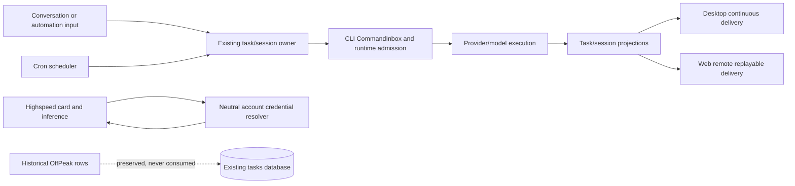

# Remove Off-Peak tasks from this fork

_Status: accepted_

This personal fork removes Off-Peak tasks because they depend on the vendor's spare-compute scheduling service and introduce dedicated execution state throughout the task framework. The implementation removes the capability and its dedicated integration instead of retaining a disabled implementation, and restores shared responsibilities to their existing owners.

This decision supersedes the OffPeak preservation sentence in [ADR 0003](0003-remove-in-app-marketing.md). It does not remove ordinary conversations, scheduled automations, background work, subagents, Highspeed, account authentication, provider selection, or request verification. Highspeed keeps execution-scoped model selection, but its Coding Plan credential resolution moves to a neutral account service.

## Existing installations

Historical task database migrations remain frozen so existing databases do not fail checksum validation. The retired `off_peak_tasks` table, retired metadata columns, and old task-group rows are left in place and are no longer consumed. Existing conversations and workspace changes remain available as ordinary tasks. A former Off-Peak system group becomes an ordinary editable group; no user files or task data are automatically deleted.

The fork updates Desktop, Web, Server, and the bundled CLI together and does not promise compatibility with the removed upstream OffPeak RPC or tool surface. Generic method-not-found, remote-control, cron, dynamic-workflow, and CUA compatibility paths remain.

## Ownership and event order

The implementation deletes OffPeak ticket polling, server clients, local task orchestration, scheduler claims and retries, Host dispatch and settlement, tool registration, protocol methods, UI surfaces, and OffPeak-only turn restrictions. It preserves one task/session owner, owner/lease checks, workspace identity, stale-run protection, normal task persistence, cron scheduling, and Desktop/mobile delivery semantics.

## Acceptance scenarios

- No application-owned OffPeak UI, tool, RPC, ticket request, polling loop, mock gateway, scheduler claim, Host dispatch, or OffPeak-only execution restriction remains.
- Existing conversations created by a retired OffPeak run open, resume, and accept ordinary prompts. Existing group membership, ordering, and workspace changes remain intact.
- Cron automations, normal background work, subagents, Highspeed draw/inference, provider authentication, Team connections, request verification, dynamic workflows, and Keep Awake continue through their existing owners.
- Historical task database migration checksums remain valid; no automatic deletion or destructive cleanup is introduced.
- Root typecheck, lint, architecture checks, affected tests, CLI checks, and relevant build checks report their actual results.
