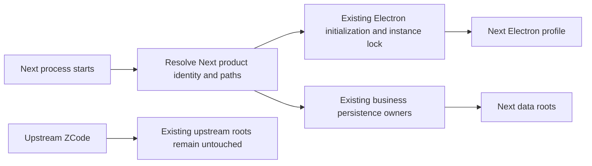

# Separate ZCode Next's product identity and persisted data

_Status: accepted on 2026-10-17_

The reactive cleanup policy and Next upgrade-continuity commitments below are superseded by [ADR 0006](0006-retire-pre-release-compatibility-debt.md). Product separation and the retained capability boundaries remain in effect.

The user has named this personal fork **ZCode Next**, required its data directories to be separate from upstream ZCode, and removed future compatibility with upstream ZCode as a product requirement. Limit implementation to product-facing names and the identifiers and paths required for separation; retain internal package names, source directories, protocol field names that do not cause collisions, and the existing artwork.

## Confirmed boundaries

- Legacy MCP discovery only reads an explicitly selected path; it never scans upstream Electron profiles.
- Next starts with fresh tasks, settings, account state, provider configuration, and business device identity. Do not automatically read, import, migrate, or delete upstream data.
- Upstream ZCode and Next must support side-by-side installation and concurrent operation. Separation includes business data, Electron profiles, installation identities, single-instance ownership, and conflicting system launch integrations.
- Next's future upgrades preserve Next's own data and business device identity. For the transition from upstream to Next, this decision supersedes the legacy device-identity migration requirement in [ADR 0002](0002-remove-automatic-telemetry.md).
- Upstream data, client, and protocol compatibility is no longer a product requirement. This change does not trigger a general removal of historical migrations or compatibility code; remove such paths when a concrete Next change requires it.
- Preserve current official account, model, and subscription services. Preserve existing state owners, platform abstractions, and Desktop/mobile delivery semantics.

## Ownership

Existing path and persistence owners remain responsible for their data. Resolve Next identities and paths before opening stores or acquiring the Electron single-instance lock; do not introduce another storage owner.

## Product identifiers and path rules

| Surface                                           | Proposed Next value                       |
| ------------------------------------------------- | ----------------------------------------- |
| Global application data                           | `~/.zcode-next`                           |
| Workspace-owned configuration and generated files | `.zcode-next/` and `zcode-next.json`      |
| Default parent for newly named workspaces         | `~/ZCodeNextProject`                      |
| Remote deployment root                            | `~/.zcode-next/server`                    |
| Desktop application ID                            | `dev.zcode.next`                          |
| Desktop and standalone CLI public command         | `zcode-next`                              |
| Desktop deep-link scheme                          | `zcode-next://`                           |
| Preview and development display names             | `ZCode Next Preview` and `ZCode Next Dev` |

Product-owned browser storage, cookies, temporary roots, and active system integrations receive distinct Next namespaces. Stop automatic discovery of upstream `.zcode`, `zcode.json`, and upstream browser keys. Preserve third-party formats and entry points such as `.agents`, `.claude`, `.codex`, `AGENTS.md`, and `SKILL.md`.

Keep existing `ZCODE_*` environment variable names and explicit directory overrides. With no override, resolve Next defaults; with a user-selected path, honor that exact path without upstream-directory detection or a denylist. Existing data-base-parent semantics remain intact.

Production remote workspaces require an explicitly configured asset source containing Server and Agent bundles built from Next. Do not automatically fall back to upstream runtime bundles: their own default paths would defeat Next data isolation. Reuse the existing CDN override/build configuration and development mock-CDN machinery; no new hosting or migration subsystem is introduced.

## Verification limits

Desktop callback generation and parsing now use `zcode-next://oauth/callback`. The official website intermediary and OAuth backend are outside this checkout. During validation the official website could not be reached (local DNS resolution failed and the browsing service returned HTTP 502), so live account login and the external redirect contract remain unverified; local callback, polling, and credential tests cover the in-repository behavior.

The current Computer Use Helper package is an unavailable placeholder and is not installed by this build. Renaming inactive Helper internals is outside this change.

## Acceptance scenarios

- With upstream ZCode installed and populated, first launch of Next opens fresh Next state and leaves the upstream files unchanged.
- Both products can be installed and launched independently on supported desktop platforms; their application profiles, instance ownership, and system launch integrations do not collide.
- Desktop, standalone CLI, Web/Server, and remote workspace processes resolve product-owned data through the intended Next namespaces.
- Next can reopen its own saved data after an upgrade. Existing Next database migration and device-identity guarantees remain intact.
- Product-owned visible names identify Next while retained official services and third-party integrations keep their actual identities.
- Existing task/session ownership, workspace identity, local and remote execution, and Desktop continuous/mobile replayable delivery behavior remain intact.

The user confirmed all recommendations in both interview rounds before implementation. Validation evidence will be recorded after implementation.

## Validation on 2026-10-17

- Root `pnpm typecheck` and CLI `pnpm --dir apps/zcode-cli typecheck` passed. Root lint passed with 52 warnings and no errors; architecture checks reported zero violations within configured coverage. Desktop E2E typecheck passed.
- The root full unit entry point ran 1,744 files: 1,740 passed, two skipped, and two had four product-name assertions needing updates (16,066 tests passed and 20 skipped). Those assertions were updated and both affected files then passed all 17 tests. Focused service/remote checks passed 1,330 tests; Desktop identity/profile/protocol tests passed 377 with four skipped; Web/UI integration checks passed 523. The added legacy-MCP isolation and IPC checks passed five tests.
- CLI isolation/configuration/skills/commands checks passed 67 tests, self-identification/context tests passed 96, bundled-workflow skill contract checks passed 26, and command-name/process checks passed eight. Distribution routing and installation checks passed five, including preservation of an existing upstream launcher.
- The complete CLI test entry point was executed with `--continue` in an isolated home. It remains nonzero across contracts, adapters, core, bootstrap, TUI and CLI tests, including missing model-catalog fixtures, provider-contract mismatches and SEA fixtures. Rename-related command assertions, a Windows path fixture, and workflow Markdown contract formatting were corrected and verified separately. This is not a claim that the full CLI suite is green.
- CLI lint still reports the existing errors (including file-size limits). Comparing the affected CLI source packages against HEAD found the same error counts and no new error signatures. Root `pnpm fmt:check` still fails on existing formatting and invalid vendored Electron HTML; formatting changes introduced by this work were checked against the baseline and corrected without rewriting embedded skill contracts.
- Desktop production bundles, Web production build and the standalone CLI bundle passed. Existing bundle-size and dynamic-import warnings remain.
- Browser checks covered Chinese and English share-page names and Next deep links at desktop and mobile widths, using light and dark themes. No horizontal overflow was observed. These use local fixtures, not a live official account.
- Validation ran on Linux with Node 24.14.0 and pnpm 10.33.2. Native Windows/macOS installation coexistence, live remote deployment and live OAuth redirect acceptance remain unverified. Production remote runtime assets require a Next-built configured source.
