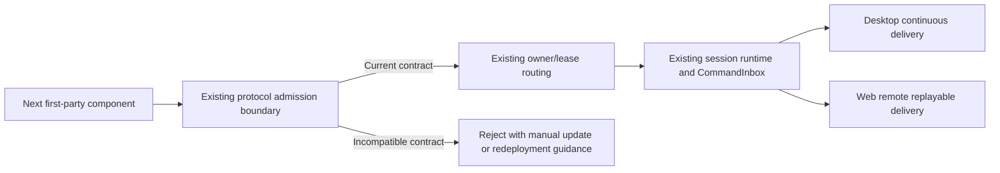

# Retire compatibility debt before the Next release baseline

_Status: accepted on 2026-10-18_

ZCode Next is in early development and has no declared release baseline. Proactively remove compatibility paths whose only beneficiaries are upstream ZCode or previous Next development builds, and consolidate interfaces, state ownership, and execution paths made redundant by their removal. Each candidate must be assessed against its current consumers and acceptance scenarios; a legacy or compatibility label alone does not establish that it is obsolete.

Preserve current Next capabilities: Desktop, Web, mobile remote control, the standalone CLI, remote workspaces, Windows/macOS/Linux support, official account/model/subscription services, and third-party integrations. Adapters and safeguards required by these capabilities or actual external service contracts remain necessary.

Incompatible changes to Next-owned development data and formats are acceptable before the release baseline. Preserving earlier development-build conversations, settings, provider configuration, and business device identity across such changes is not a product requirement. Upstream ZCode data remains isolated and untouched.

This decision supersedes [ADR 0005](0005-separate-zcode-next-product-and-data.md)'s reactive cleanup policy and Next upgrade-continuity commitments, and [ADR 0004](0004-remove-off-peak-tasks.md)'s frozen historical-migration requirement during pre-release development. Product separation and the current capability boundaries remain in effect.

## Development data

Use the current Next data format as the single supported format. Historical migration sequences may be consolidated into initialization of the current schema; old development data does not require migration, dual reads, or legacy-field writeback.

When stored data is incompatible, fail clearly and provide manual reset instructions for the affected Next-owned state, respecting configured data roots. Preserve project source and workspace files. Do not silently erase data or introduce a general automatic cleanup subsystem.

The [development data reset guide](../development-data-reset.md) describes manual recovery and paired-component deployment.

## Internal component contracts

Support paired Desktop, Web, Server, CLI, and remote Agent components using the current internal protocol contracts. Compatibility with older internal RPC names, event formats, and protocol generations is not required. Reject incompatible peers clearly and direct the user to update or redeploy the corresponding components through the existing manual workflow.

Admission is based on the internal protocol contract, not strict equality of product version numbers or a check for newer builds. Keep admission at existing protocol boundaries and retain task/session ownership, owner/lease routing, stale-run protection, normal reconnection, mobile replay, and current external service contracts.

## Implementation record

Implemented on 2026-10-18:

| Owner                               | Current behavior                                                                                                                                                                                                                                                                                                                         |
| ----------------------------------- | ---------------------------------------------------------------------------------------------------------------------------------------------------------------------------------------------------------------------------------------------------------------------------------------------------------------------------------------- |
| Task and automation database        | Initialize `0001_next_schema`; validate the baseline checksum and required schema objects on each connection. Remove retired off-peak storage and startup ID/group repairs.                                                                                                                                                              |
| CLI session database                | Initialize `0001_next_session_store`; reject previous ledgers or incomplete current schemas before changing journal mode. Preserve current session fork/remapping and transaction boundaries.                                                                                                                                            |
| Settings and provider configuration | Remove upstream imports, historical account/provider field conversion, reasoning aliases, migration markers, and reads that write converted configuration. Existing owners retain atomic writes and current configuration validation.                                                                                                    |
| Subagent state                      | Host and standalone CLI use one current persisted-state schema. Invalid or historical state fails with the affected path; Agent Markdown and project files are not rewritten.                                                                                                                                                            |
| MCP and provider UI                 | Remove legacy MCP import endpoints, browser-storage migration, `enable` field conversion, directory-override cleanup, and provider-family migration startup gates. Desktop, Host, and CLI share current MCP admission; reads do not write converted configuration. Keep current MCP directory operations and third-party import formats. |
| Internal connections                | Require the shared current protocol contract at Agent, stdio, remote handshake, and HTTP capability admission. Remove retired RPC aliases and optional workflow-delta delivery.                                                                                                                                                          |

Connection admission precedes business requests and availability publication. Existing runtime owners retain CommandInbox admission, owner/lease routing, stale-run checks, Desktop continuous delivery, and mobile replay. Workflow children now receive the resolved parent shell selection from its runtime owner rather than an earlier configuration copy.

Architecture policy entrypoints now refer to existing session contracts. The checker rejects a missing declared public entrypoint even for an unmanaged module. Dependency and layer enforcement otherwise retain the coverage explicitly declared in `architecture-policy.yaml`.

## Verification record

Verification used the pinned Node 24.14.0 toolchain:

- Root `pnpm test:unit`: 1,739 files and 16,052 tests passed; 2 files and 20 tests skipped. Subsequent Subagent and MCP admission changes were checked with the affected Host, Desktop, UI, and CLI tests.
- Final admission-focused checks passed: MCP/settings/UI, 7 files and 124 tests; CLI configuration, 6 files and 106 tests; Host Subagent state, 84 tests with 8 skipped; CLI Subagent state, 14 tests. Current CLI cold-resume fixtures also passed all 47 tests.
- Root and standalone CLI type checking passed. Root lint passed with 52 warnings and no errors; changed architecture checks reported zero violations. The architecture checker regression suite passed all 13 tests.
- Desktop `build:no-runtime-assets`, Web build, and standalone `cli:build` passed. A built CLI process accepted current protocol initialization through NDJSON with isolated temporary state.
- Focused coverage exercises old-data rejection without mutation, current-store reopening, concurrent initialization, transactions, settings write ordering, provider configuration, MCP operations, handshake rejection, remote deployment, workflow delivery, and Subagent state recovery. Paired-component coverage does not replace a packaged cross-platform E2E run.
- The standalone CLI full suite and CLI lint are not green. Remaining failures include stale provider fixtures, PDF/SEA fixture or export assumptions, I/O and file-size boundary assertions, and runtime event expectations. Unchanged provider tests still use `label` where the current owner exposes `providerName`. These failures are not hidden by adding compatibility paths back.
- Whole-repository `pnpm fmt:check` still reports failures outside this cleanup, including vendored Electron HTML. Changed files are formatted and checked separately.
- `pnpm knip` still reports repository-wide unused files, exports, and dependencies. Targeted reference tracing removed the retired MCP enabled-state storage key and narrowed helpers to their actual local callers; this change does not establish a clean whole-repository unused-code baseline.

Manual recovery remains limited to the exact affected file and SQLite sidecars described in the reset guide. No real user store, project, or workspace was reset during implementation or verification.
