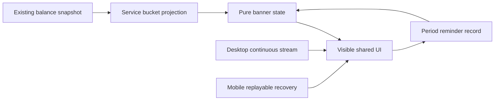

# Start Plan quota bucket reminders

ADR [0003](adr/0003-remove-in-app-marketing.md) removes sales actions from quota
reminders. Dismissal, bucket identity and actual entitlement enforcement remain
with their existing owners.

## Behavior

- Do not show 50% or 20% reminders. Evaluate each active bucket for the current
  model independently using `remaining_units / total_units`; only a ratio above
  zero and at most 10% is a low-quota candidate.
- Daily and one-time buckets retain their distinct factual labels. Other periods
  use a neutral plan-quota label. Do not combine bucket percentages or infer a
  period type from an unknown value.
- A `bucket_id + period_start + period_end` is displayed once. Balance, model,
  task and local date are not part of its identity. A bucket shared by models
  still has one reminder; a new bucket or period can create a new reminder.
- Low-quota notices are dismissible and have no upgrade action. Their visible
  values may update, but closing, switching task/model, remounting, or recovering
  quota and crossing the threshold again does not repeat the same period.
  Candidate ordering follows the server; a previously displayed bucket must not
  prevent another eligible bucket from appearing.
- Report model exhaustion only when every active bucket for that model is
  exhausted. Report total exhaustion when every active model bucket is
  exhausted. A depleted one-time allowance must not conceal a remaining daily
  allowance. Total exhaustion has priority over model exhaustion; server code
  1005 still reports total exhaustion. Notices do not block sending or grant
  execution rights. Rate limits, concurrency and MCP restrictions keep their
  existing handling and factual recovery instructions.

## Data and time

The existing `zcode-plan/billing/balance` request supplies bucket and user-plan
ids, period boundaries and expiration. Services project these into the existing
`UsageQuotaLimit` and convert timestamps to milliseconds. Period labels join
plan entitlements by `user_plan_id` (or legacy `plan_id`) and entitlement id.
Only model-usage buckets participate; known expired and pending buckets do not.

Bucket validity, reminder admission and expiry cleanup use the same
`snapshot.serverTime`, falling back to `generatedAt`. Do not advance cached
snapshot time with the device clock or replace period identity with
`expires_at`. Missing or non-finite values do not imply zero. Legacy snapshots
without a stable bucket id and period cannot create a low-quota reminder, but
explicit remaining values can still establish exhaustion.

A reminder record is localStorage data keyed by bucket period. It contains no
token, account plaintext, balance, model or task. It survives client restarts;
different clients retain independent records. Unavailable storage falls back to
renderer memory. Dismissal releases the registered display owner without
re-evaluating the period against device time.

## Ownership and delivery

`sessionQuotaBannerState` owns pure presentation decisions.
`startPlanQuotaReminderStore` owns period-scoped display admission.
`sessionQuotaBannerDismissalStore` continues to own session-scoped dismissal for
other errors. A hidden page, a notice obscured by another error, or merely
computing a candidate does not consume its display opportunity.

The shared UI supports Desktop and mobile Web, both locales and both themes.
This does not alter Agent protocols, accepted queues, snapshot recovery, Host
attachments or runtime ownership.

## Regression evidence

Verify threshold boundaries, independent daily/one-time buckets, per-model and
total exhaustion, malformed values, pending/expired buckets, StrictMode,
remount, task/model switches, reload, and new bucket/period admission. Browser
fixtures use the current Account Source snapshot contract and the same
UsageEntitlement cache identity as the banner.

Clock-skew cases must remain valid: a device clock before or after the period
boundary cannot prevent admission or dismissal while the authoritative snapshot
still considers the bucket valid. A new period snapshot may create a new
reminder. Do not add a second dismissal owner or timeout workaround.
