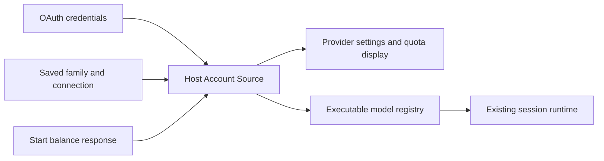

# Z.ai / BigModel Start Plan Provider

Start is an independent account provider for already-granted entitlements. This
fork retains manual model selection and actual quota enforcement. ADR
[0003](adr/0003-remove-in-app-marketing.md) removes new Start claims, promotional
previews, automatic Start recommendations, and purchase or upgrade actions.

## Ownership and identity

Account selection persists `providerFamilyDomain` and
`providerFamilyConnectionSelections`. Account Source publishes availability,
current access, activation time, entitlement and dynamic model membership in the
same revision. Settings and Registry consume that revision; UI projections do
not grant access.

The provider ids are `account:zai-start-plan` and
`account:bigmodel-start-plan`. Each uses its own login domain and credential
scope. Start and the selected personal or team connection can both be current
for the same brand; Start's connection key does not include the paid connection.
Team discovery still requires the exact organization, project and product.

A saved Start selection resolves its exact provider, model and options. It does
not fall back to another brand or paid quota. Historical sessions, Automations,
Subagents, Bots and Wiki selections are not rewritten. Existing text-only
`createSelectionSideSession.firstInput` uses the normal child inheritance path.
There is no Start recommendation before sending, creating a side conversation,
or saving Automation and Subagent settings.

## Entitlements and balance

Start availability is queried independently of individual Coding Plan and team
entitlements. The authenticated `zcode-plan/billing/balance` request supplies
both active plans and balances in one snapshot; do not make a preliminary
`billing/current` request or a second balance request for the same observation.
Use the current `ZCODE_VERSION` for `app_version`.

The request needs the OAuth backend JWT and `X-Device-Mid`. Desktop, remote
server and CLI must ensure their own business device identity exists before
querying; see [device identity](zcode-endpoint-device-mid-header.md). Missing
identity or a failed request must not become positive entitlement.

Pending activation retains Unix-second `effectiveAt` with `entitled=false`.
An active plan with no models can remain entitled but publishes an empty model
membership. A failed query can retain a recent successful observation only for
the same account and access context. Expired, unknown, unassigned or exhausted
states never bypass Registry or runtime enforcement.

Settings refresh and composer balance use the existing UsageEntitlement owner,
cache identity, refresh events, coalescing and error policy. Login refresh keeps
its existing account-refresh order. Reading or remounting a panel does not
manufacture a fresh positive balance.

## Presentation

Start remains visible in settings for the current login brand. Signed-out users
can sign in; first-query failures offer retry; explicit authentication expiry
offers login. No-plan and expired states show neutral facts. The model menu
contains only executable models from Account Source and Registry.

An active Start response renders one card per `plans[]` entry in server order.
Each card shows its remote plan name, `ends_at`, and only buckets with the same
`plan_id`. There is no fallback that copies unassigned buckets onto every card.
Every bucket uses its own `expires_at` for its reset label, never a plan-level or
aggregate reset time. Preserve `bucket_id`, `user_plan_id`, `period_start` and
`period_end` for reminder identity. See
[quota reminders](start-plan-daily-quota-banner.md).

The server guarantees that each balance bucket belongs to an active returned
plan. `warnOnUnattributedStartPlanBuckets` diagnoses violations. The read-only
Models section uses the case-insensitive capability union in first occurrence
order. Model switching notices continue to distinguish individual, team and
Start allowance sources, including when the model name is the same.

Provider endpoints and credentials remain account-managed. Model ids and
server-owned membership are read-only; local context-window overrides and
connectivity checks continue through existing provider configuration interfaces.
Refresh can remove a model that is no longer entitled even if it has a local
context-window override.

Start has no separate disconnect or subscription-management action. Existing
individual and team subscription management remains an explicit external action
on their own cards. Low balance, exhausted quota, rate and concurrency limits,
and MCP restrictions retain their factual explanations and manual recovery
paths without sales actions.
