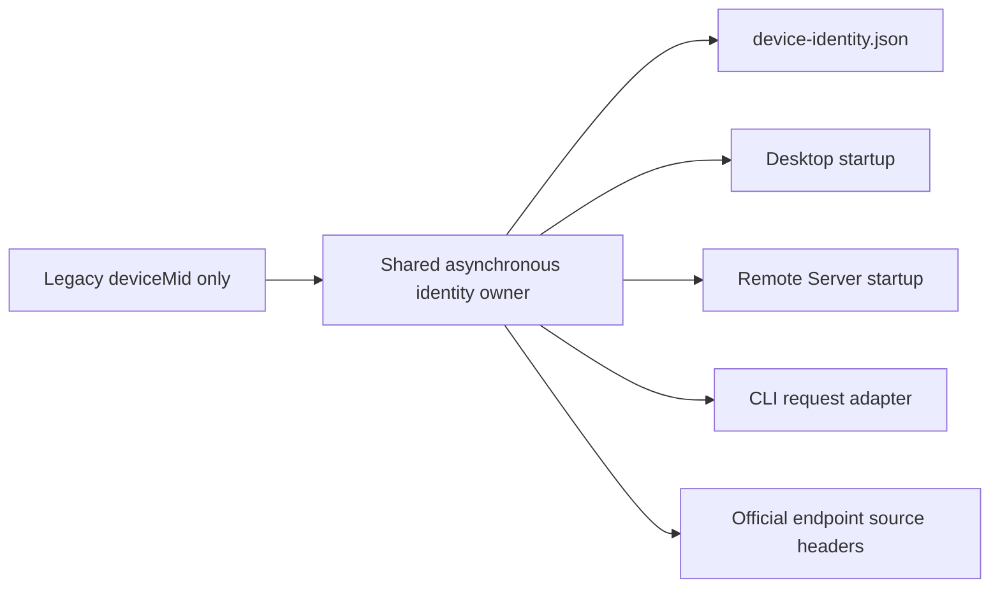

# Business device identity for official service requests

Official model and subscription requests require a stable `X-Device-Mid`. Desktop, the remote Server, and standalone CLI use `ensureBusinessDeviceMid` from `@zcode/shared/node` as their single asynchronous storage owner.

The owner reads `<appConfigDir>/device-identity.json`. When it is missing or invalid, the owner reads only `deviceMid` from the legacy `telemetry-state.json`, or generates a UUID if no identity exists. A file lock and atomic private write protect concurrent processes. Other legacy state is neither copied nor deleted. In-process callers share initialization; failed persistent initialization can be retried.

Desktop initializes before constructing clients. The stdio Server initializes after its handshake and before services are created. CLI resolves the identity from its own data directory; colocated processes use the same identity. Desktop and CLI retain their existing process-level fallback when storage is unavailable; the Server reports initialization failure through its existing startup handling.

`packages/services/src/providers/sourceHeaders.ts` awaits identity initialization and applies the shared header normalization rules. `NodeApiClient` adds these headers only to requests for the current ZCode endpoint, preserves caller overrides, and rechecks cancellation after asynchronous preparation. Unrelated HTTP requests retain their ordinary path. Invalid header values are omitted.

Start Plan balance requires this identity: a missing header can make the backend reject the request as a parameter error and hide the entitlement. Identity migration and endpoint-header tests cover this boundary independently of any reporting subsystem.
